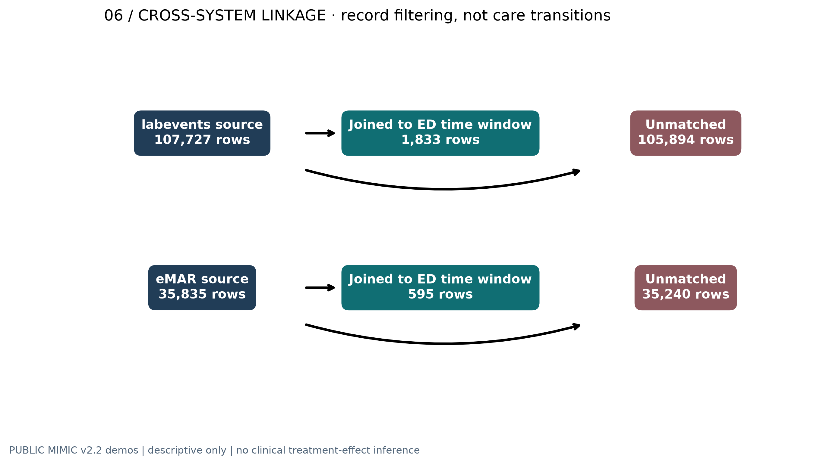

# Observation-Aware EHR Data

**Temporal data provenance · Decision-time retrieval · Reproducible clinical data engineering**

A research implementation for reconstructing and querying EHR event histories without conflating clinical event time with recorded information availability.

**Study status:** Reproduced on public MIMIC-IV demonstration data. Not clinically validated.

**Researcher and maintainer:** Farshid Bagheri Saravi  
**Affiliation:** Department of Electrical, Computer and Systems Engineering, Case Western Reserve University  
**Research context:** Temporal clinical informatics and causal machine learning for treatment-timing research

[Research methods](docs/PROTOCOL.md) · [Figures and interpretation](docs/FIGURES.md) · [Engineering architecture](docs/ARCHITECTURE.md) · [Verification](evidence/VERIFICATION.md) · [Limitations](docs/RESEARCH_LIMITATIONS.md) · [Citation](CITATION.cff) · [Data rights](RIGHTS_AND_LICENSES.md)

## Overview

Electronic health records contain multiple timestamps that represent different events: measurement, documentation, storage, and possible information availability. Treating them as interchangeable can contaminate retrospective decision-time analyses.

This repository implements an **observation-aware event model** and compares indexed as-of retrieval in SQLite and MongoDB against an independent reference. It also provides a CI-reproduced descriptive atlas of the two **public MIMIC-IV demonstration datasets**. The data-engineering work supports, but does not constitute, a causal model of antibiotic timing in sepsis.

| Public-demo evidence | Verified scope |
|:--|--:|
| Emergency department encounters | **222** |
| Unique ED patients in this selected subset | **64** |
| ED vital-sign records | **1,038** |
| Hospital laboratory records linked to an ED interval | **1,833** |
| Hospital medication-administration-system records linked to an ED interval | **595** |
| Source CSV tables inspected | **37** |
| Descriptive scientific figures | **7** |

Counts represent a selected, de-identified demonstration sample, **not** a representative clinical cohort. A matched eMAR record does not by itself establish the first IV antibiotic administration time. [Source and denominator definitions](docs/FIGURES.md).

## Results gallery

The figures below are **real-data descriptive analyses**, not treatment-effect estimates or model-performance claims. Select an image to inspect its original resolution and SVG counterpart in the [figures directory](evidence/publication_atlas/figures/).

### Observation coverage across the ED stay


*Figure 1.* Proportion of eligible ED stays with a recorded vital-sign field in each time interval. Low-count cells are suppressed; denominators change with encounter duration. [Methods](docs/FIGURES.md#observation-coverage).

### Timing and cross-system documentation


*Figure 3.* Time-dependent **recording** of ED dispensing, laboratory, and medication-system records; these curves are not antibiotic administration or clinician-observation rates.


*Figure 5.* Distribution of laboratory chart-to-storage timestamps. Storage time is not necessarily clinician viewing time.

### Cross-system linkage and data provenance



*Figure 6.* Conservative hospital–ED linkage using patient, admission, and interval constraints; the flows count **records**, not individual patients or clinical transitions.

### Other figures

[Field completeness](evidence/publication_atlas/figures/02_completeness_intervals.png) · [ED encounter durations](evidence/publication_atlas/figures/04_encounter_duration.png) · [Schema fingerprint of all 37 source tables](evidence/publication_atlas/figures/07_schema_fingerprint.png)

All seven plots are available as PNG and vector SVG. [Figure captions, assumptions, and denominators](docs/FIGURES.md).

## Reproducibility

Requirements: Python **3.11**, internet access for the open PhysioNet downloads, and optionally Docker with MongoDB 7 for a live database comparison.

```bash
python -m venv .venv
source .venv/bin/activate
python -m pip install -e ".[analysis,test,mongo]"

# Download the official public releases and check their SHA-256 manifests.
python scripts/fetch_demo.py --dataset both

# Reproduce the atlas using the real demo records.
python scripts/publication_atlas.py
python scripts/source_inventory.py

# Run all local tests.
python -m pytest -q

# Optional: start MongoDB, then execute matched as-of queries.
docker compose up -d
python -m obs_ehr prepare --mode strict --ed-dir data/raw/ed --hosp-dir data/raw/hosp --output outputs/events_strict.jsonl
python -m obs_ehr benchmark --input outputs/events_strict.jsonl --backend both --repeats 10 --max-stays 60 --output outputs/benchmark.json
```

Generated plots and the local HTML dashboard live in `evidence/publication_atlas/`. **GitHub's file viewer displays HTML source rather than executing the dashboard.** To interact with it, [download the repository as ZIP](https://github.com/Farshidbagheri/Observation-aware-ehr-data/archive/refs/heads/main.zip), extract it, and open `evidence/publication_atlas/index.html` in a web browser. The original SVG images must remain in the adjacent `figures/` directory. While the repository remains private, GitHub sign-in is required.

[Successful real-data verification](https://github.com/Farshidbagheri/Observation-aware-ehr-data/actions/runs/40804105789) · [Successful atlas reproduction](https://github.com/Farshidbagheri/Observation-aware-ehr-data/actions/runs/40804105595) · [Measured SQLite/MongoDB benchmark](evidence/CI_LIVE_MONGODB_RESULTS.md). Inspect [GitHub Actions](https://github.com/Farshidbagheri/Observation-aware-ehr-data/actions) for the current status of later commits.

## What the implementation establishes

- **Time semantics:** Source event time and declared availability time are recorded separately, with each proxy or unknown timestamp explicitly identified.
- **As-of retrieval:** A reference implementation checks the records returned by indexed SQLite and MongoDB queries at specified landmarks.
- **Conservative source integration:** Hospital laboratory and medication-system records are joined to ED stays only when identifier and temporal checks pass.
- **Auditable analysis:** Figure source, units, denominators, suppression rules, dataset versions, and validation coverage are documented.
- **Reproducibility:** Source-download checksums, test suites, CI execution, machine-readable aggregates, and original vector figures are available.

The distinguishing engineering contribution here is a **testable observation-availability contract across two storage backends** and an evidence-linked examination of how missing, irregular, and delayed documentation affects temporal data representation. This is not a claim of first invention, superior database performance, or improved patient outcomes.

## Boundaries

**Not implemented or validated:** clinician-view timestamps, full bitemporal corrections, clinically adjudicated suspected-sepsis eligibility, patient-specific optimal antibiotic treatment timing, prospective decision support, or external clinical validation. A small public demo cannot substantiate model discrimination, SHAP attributions, survival calibration, or causal policy benefit. See the [metric applicability review](docs/EVALUATION_APPLICABILITY.md).

The public MIMIC-IV-ED and MIMIC-IV clinical demos are attributed to their [PhysioNet ED source](https://physionet.org/content/mimic-iv-ed-demo/2.2/) and [clinical source](https://physionet.org/content/mimic-iv-demo/2.2/). Their **ODbL 1.0 data licensing is separate from the software**. Raw tables, patient-level derivatives, and restricted health-system data are not committed. Original research software is distributed under the [MIT License](LICENSE) insofar as the author holds licensing rights; the source data retain ODbL 1.0. [Rights and attribution](RIGHTS_AND_LICENSES.md).

## Project structure

```text
src/obs_ehr/             Event normalization, storage adapters, as-of reference and benchmark
scripts/                 Data acquisition, descriptive atlas, source-schema inventory
tests/                   Unit, real-demo and live-database checks
evidence/publication_atlas/
  figures/               Publication figures (PNG + SVG)
  aggregate_results.json Aggregate study summary and metric applicability
  all_source_schema_inventory.json
  index.html             Local dashboard (not rendered in GitHub's code viewer)
docs/                    Protocol, architecture, figure interpretation and limitations
.github/workflows/       Research verification and reproducibility automation
```

**Technical audit:** [review findings and remaining work](docs/REVIEW_REPORT.md). **Release readiness:** [publication checklist](docs/PUBLISH_CHECKLIST.md).

## Data, licensing and citation

**Original software:** [MIT License](LICENSE), copyright © 2026 Farshid Bagheri Saravi,
subject to the author's rights to license the code. **Public MIMIC-IV demonstration
data:** [ODbL 1.0](https://opendatacommons.org/licenses/odbl/1-0/);
this repository does **not** ship the clinical source tables. Derived figures are
attributed to the original datasets and do not authorize redistribution of
credential-restricted clinical records.
See [file and data rights](RIGHTS_AND_LICENSES.md).

**Dataset citations:** [MIMIC-IV-ED Demo 2.2](https://doi.org/10.13026/jzz5-vs76)
and [MIMIC-IV Clinical Database Demo 2.2](https://doi.org/10.13026/dp1f-ex47).
Both should be cited separately when using the analyses.

**Research software DOI:** `10.5281/zenodo.23752944` is **reserved for the planned
Zenodo v0.3.0 software deposit**. It is **not yet published or citable**.
After the Zenodo record is published, the confirmed software DOI and its
version-specific metadata will be placed in [CITATION.cff](CITATION.cff) and
here. [Zenodo deposit procedure](docs/ZENODO_RELEASE.md).

## Research outlook

The next research phase will evaluate correction-aware event histories,
alternative information-availability assumptions, and repeated workload
benchmarking with well-specified SQL and MongoDB storage representations.
A future causal study of antibiotic-initiation timing would additionally
require an authorized outcome-linked cohort, adjudicated exposures, an
explicit target-trial estimand, and independent clinical validation.
These are **planned investigations**, not results of the public-demo atlas.
[Roadmap](docs/ENGINEERING_ROADMAP.md).

*Farshid Bagheri Saravi · Case Western Reserve University*

[Website](https://www.farshidbagheri.com) ·
[Google Scholar](https://scholar.google.com/citations?user=cnkhpngAAAAJ) ·
[ORCID](https://orcid.org/0000-0003-4213-5053) ·
[LinkedIn](https://www.linkedin.com/in/farshidbagherisaravi)


