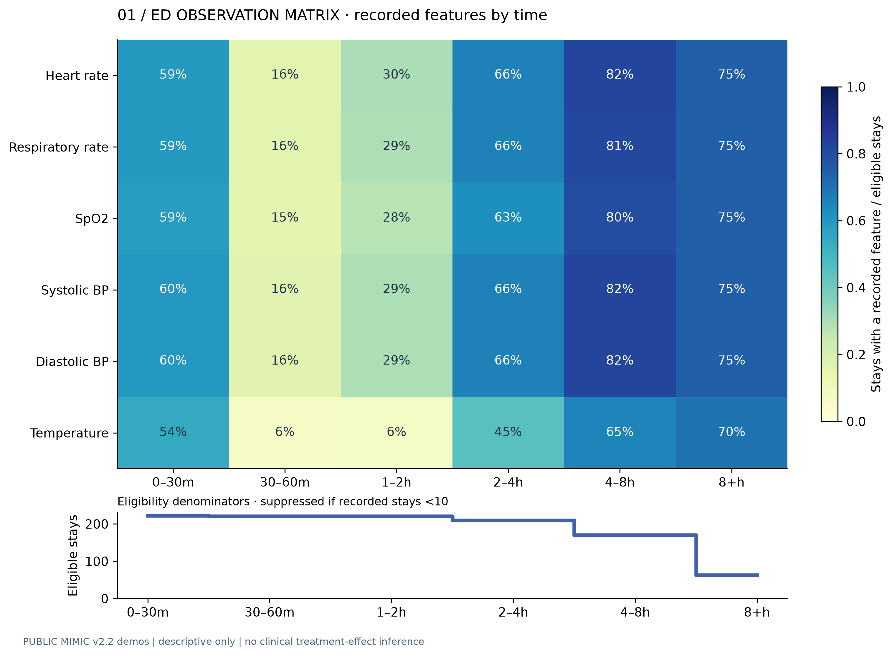
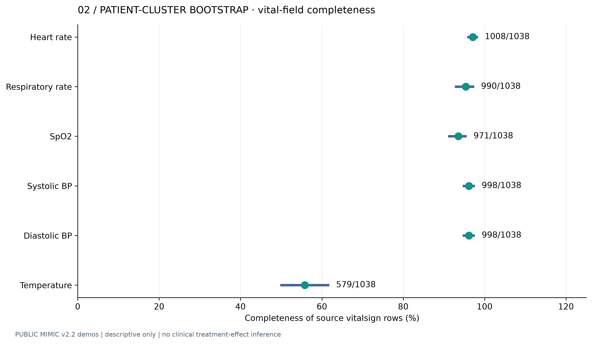
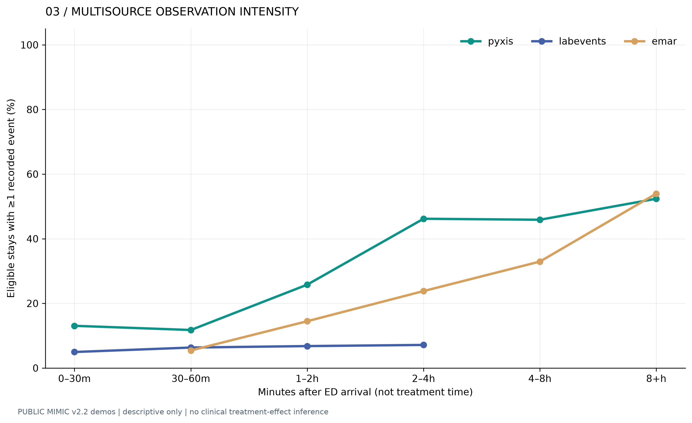
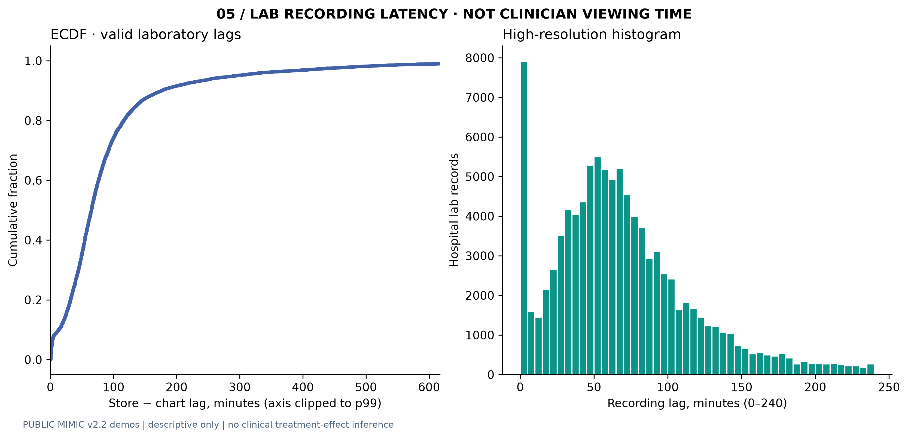
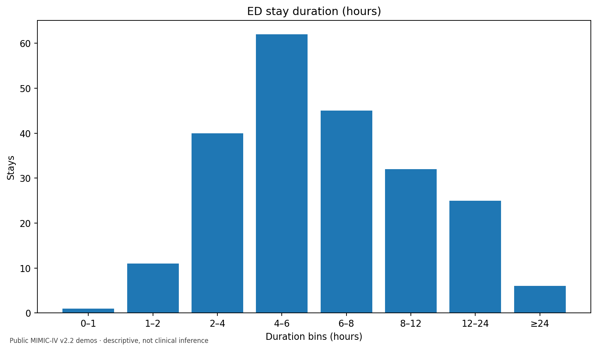
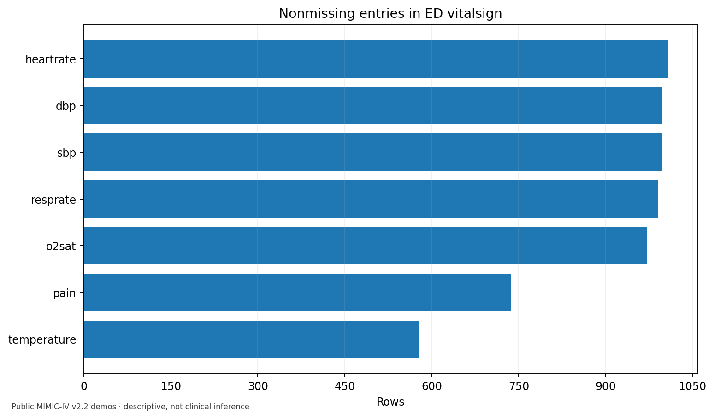
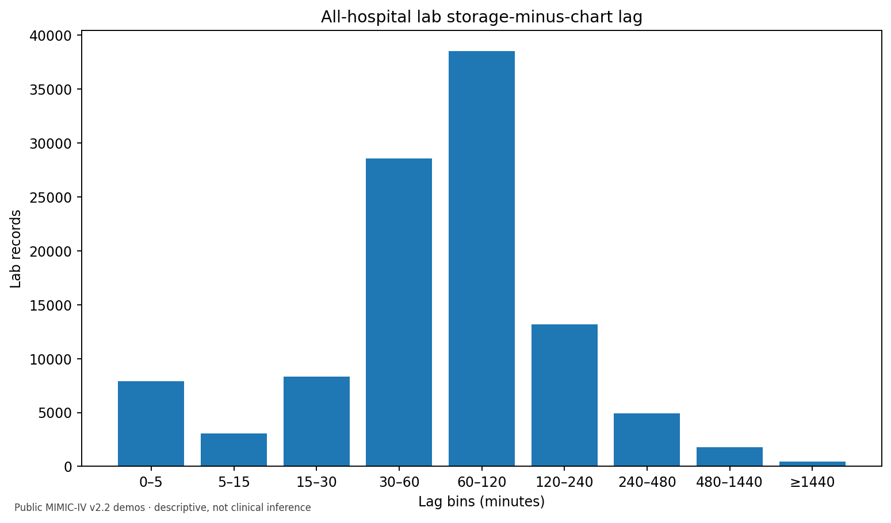
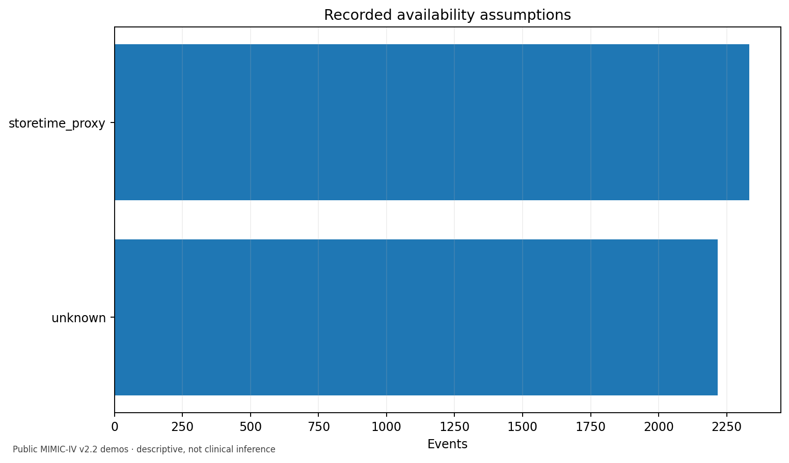

# Observation Atlas — Real Clinical Data Engineering

**Observation-aware EHR evidence, not simulated patients or unvalidated medical claims.** Developed with public de-identified MIMIC-IV v2.2 demonstration datasets, a temporal storage ledger and auditable cross-system joins.

[](evidence/publication_atlas/index.html) [](docs/EVALUATION_APPLICABILITY.md) [](https://github.com/Farshidbagheri/Observation-aware-ehr-data/actions/workflows/research-verification.yml)

## Featured research figures

These images are generated by `scripts/publication_atlas.py` from real public-source data and are committed **only after the automated real-data verification passes**.

| Observation process | Evidence & uncertainty |
|---|---|
|  |  |
|  |  |

**[Full research atlas and dashboard](evidence/publication_atlas/index.html) · [Methods, metric applicability and safety gates](docs/EVALUATION_APPLICABILITY.md) · [Machine-readable aggregate audit](evidence/publication_atlas/aggregate_results.json)**

### Interpretation safeguards

Every time-bin rate uses **eligible ED stays**, not total hospital rows; sparse cells are suppressed. `charttime` is not proof that a clinician viewed a value, `storetime` is a storage proxy, and Pyxis is dispensing rather than antibiotic administration. The dataset is a selected public demo, **not** a validated sepsis cohort. AUPRC, dynamic AUROC, C-index, calibration, SHAP, conformal coverage and causal treatment effects are explicitly marked **not applicable** until real model predictions, outcomes and appropriate validation exist.

```bash
python -m pip install -e '.[analysis,test]'
python scripts/fetch_demo.py --dataset both
PYTHONPATH=.:src pytest -q tests/test_publication_atlas.py
python scripts/publication_atlas.py
# Open evidence/publication_atlas/index.html
```

---

## Existing engineering implementation

**Reproducible research demonstrator: ED events, information-availability assumptions, SQLite vs MongoDB, and toy causal truth.**

Research question: when can a longitudinal EHR history be reconstructed without including information unavailable at the clinical decision landmark? This repository is scoped to **data semantics and evaluation** supporting a Ph.D. research program on causal machine learning for antibiotic initiation timing in sepsis. It is **not** an estimated clinical treatment effect or an antibiotic-timing recommendation.

## Design and evidence labels

- **`event_time`** is an original documented chart time, if available. It is not necessarily when a clinician first observed the event.
- **`available_at`** is **unknown** unless an explicit assumption is declared. Never impute missing availability as known without recording an assumption.
- **`charttime_proxy`** assumes ED charttime approximates availability; this is only a sensitivity assumption, **not verified access time**.
- **`storetime_proxy`** uses hospital record storage time (where supplied); this is **not proof** of clinician viewing/access.
- **`synthetic_delay`** deliberately invents release delays for falsifiable leakage-testing; these delays are **not actual MIMIC timestamps**.
- **`pyxis`** records medication *dispensing*, **not administration of the first antibiotic dose**. Without an independent administration record, do not estimate sepsis antibiotic effects.
- Triage/medrecon/diagnosis have insufficient reliable event-time semantics for this minimal as-of experiment and are excluded from the timed event stream.

## Data sources

Two **open** PhysioNet v2.2 demos share the same 100 patients:

1. MIMIC-IV-ED Demo: https://physionet.org/content/mimic-iv-ed-demo/2.2/ | DOI: https://doi.org/10.13026/jzz5-vs76.
2. MIMIC-IV Clinical Database Demo: https://physionet.org/content/mimic-iv-demo/2.2/ | DOI: https://doi.org/10.13026/dp1f-ex47.

**Data license: ODbL 1.0.** Download exclusively from original PhysioNet sources via script and retain source LICENSE/manifest. These public demos are *not* the credential-restricted full MIMIC databases. No raw data or patient-level derived outputs are committed here. Do not copy credentialed HiRID, MIMIC, MetroHealth, or AmsterdamUMCdb data into this public project.

## Quick start (Python 3.10+, terminal with internet)

```bash
python -m venv .venv
source .venv/bin/activate
python -m pip install -e '.[test,mongo]'
python scripts/fetch_demo.py --dataset both
python -m obs_ehr prepare --ed-dir data/raw/ed --hosp-dir data/raw/hosp --mode synthetic
python -m obs_ehr benchmark --backend sqlite
pytest -q tests/test_core.py
```

For a *real* MongoDB vs SQLite run, after install Docker Desktop:

```bash
docker compose up -d
python -m obs_ehr benchmark --backend both
RUN_MONGO_TEST=1 pytest -q tests/test_mongo_live.py
```

The output `outputs/benchmark.json` includes the exact observation assumptions, correctness checks and measured p50/p95 **only for the machine where you run it**. A slower or faster MongoDB result is not an assumed scientific finding. This evaluation does **not** establish clinical benefit or true physician-facing information availability. Run each backend on comparable warm/cold hardware setups before making performance claims.

If you only want ED data initially, run `python scripts/fetch_demo.py --dataset ed` and leave out `--hosp-dir`.

### Alternative: use existing publicly released ED-demo files

If the authorized *open* six MIMIC-IV-ED Demo v2.2 CSV GZIP files already exist in another repository, copy only those **public** files into `data/raw/ed/` with the official `LICENSE.txt`, original citation, and SHA256 manifest. The `.gitignore` protects them from accidental new commit. It is simpler to fetch from PhysioNet directly with `scripts/fetch_demo.py`.

## Clinical-data join caveat

The hospital labevents/emar join is intentionally **conservative**: it requires matching `subject_id` **and** `hadm_id`, and a `charttime` within the actual ED stay. Records without a matching admission ID or compatible timestamp remain unmatched. Hospital storage timestamps act as labeled proxies, and the code does not assert clinician visibility. This limited demo integration is **not** a comprehensive clinical event reconciliation. See [`docs/RESEARCH_LIMITATIONS.md`](docs/RESEARCH_LIMITATIONS.md).

## Toy counterfactual truth, separately

```bash
python -m obs_ehr toy --n 1000
```

This writes a **fully synthetic** table with both potential outcome risks for validating method code, under invented parameters. It cannot answer whether waiting to treat actual sepsis patients is beneficial/harmful. No clinical effect-size claim is supported.

## Reproduce and quality controls

- `pytest` checks no future-available events, deterministic artificial delay, correct hospital ED-join and SQLite parity with a Python reference.
- GitHub Actions runs unit tests; integration job uses a real MongoDB 7 service on a GitHub runner once this code is published.
- **External network and Docker are unavailable in the current authoring environment**, so no claim is made here that a real MongoDB/PhysioNet run has been completed. Local test results are stored separately in the delivery package.

## Relationship to prior work

This project is **independent** of the existing `GPU-Accelerated-Causal-ML` code/Zenodo v0.1.0. That prior software DOI refers to its original archived version and must not be relabeled as a MongoDB experiment. Related scientific interests include EHR observation-process effects, temporal representation learning and credible causal decision analysis.

## Data rights and ethics

Original PhysioNet datasets: ODbL 1.0, not governed by the software's choice of license. Check CWRU intellectual-property and institutional research requirements before publishing any unpublished research data/code from an ongoing sponsored project. No real clinical data beyond the open demos are required here.

### Run immediately on explicitly fictional fixture (works offline)

The following pipeline exercises normalization, explicit timestamp assumptions, joins, and SQLite correctness **without using any patient data**:

```bash
python scripts/make_fixture.py
python -m obs_ehr prepare --fixture --ed-dir data/fixture/ed --hosp-dir data/fixture/hosp --mode synthetic
python -m obs_ehr benchmark --backend sqlite
```

**Do not use fixture results in a fellowship application as measurements on MIMIC or real MongoDB.** The fixture is fictional, and the SQLite latency is local-environment-specific.

## v0.2: Verified public-demo descriptive analysis (not causal modeling)

Public-demo source archives supplied for this project were checked against their official source `SHA256SUMS.txt`: **6/6 ED and 31/31 clinical `.csv.gz` files matched**. On those real, de-identified files, strict-mode event normalization produced **4,548 events** (1,038 ED vital chart rows; 1,082 Pyxis dispensing rows; 1,833 hospital lab and 595 eMAR records conservatively matched into ED windows). Among these, 2,332 events have a hospital storage-time proxy; 2,216 have **unknown actual availability**. These counts describe the supplied 100-patient-demo source subsets, not a sepsis cohort.

```bash
python -m pip install -e '.[test,analysis]'
python scripts/fetch_demo.py --dataset both
python -m obs_ehr prepare --mode strict --ed-dir data/raw/ed --hosp-dir data/raw/hosp --output outputs/events_strict.jsonl
python -m obs_ehr benchmark --input outputs/events_strict.jsonl --backend sqlite --repeats 10 --max-stays 60 --output outputs/benchmark_strict_sqlite.json
python scripts/analyze_demo.py
pytest -q
```

The analysis generates **12 PNG/SVG plots** (`reports/local/figures`) and an aggregate-only JSON quality profile (`reports/local/mimic_demo_profile.json`). A versioned verified aggregate snapshot is in `evidence/real_mimic_demo_profile_v0.2.json`, with machine-specific SQLite numbers described separately in `evidence/LOCAL_SQLITE_RUN.md`. Running a local `docker compose up -d` and `--backend both` is needed for a **genuine MongoDB** performance comparison: the source workspace has not yet run it.

**What matters for researchers:** clinical histories in the real demos are not reliable counterfactual ground truth. The useful result here is an auditable, falsifiable **event-availability contract** and real descriptive audit. See [Protocol](docs/PROTOCOL.md) and [Engineering roadmap](docs/ENGINEERING_ROADMAP.md).


## Verified visual evidence gallery

These four previews are from the **actual deidentified public MIMIC-IV v2.2 demonstration datasets**, not synthetic patient cohorts. Browse all **12 SVG and PNG pairs** in [`evidence/figures/`](evidence/figures/) or open the [interactive aggregate-only dashboard](evidence/verified_demo_dashboard.html).

| ED encounter duration | Vital measurement completeness |
|---|---|
|  |  |
| Hospital lab recording delay | Declared availability sources |
|  |  |

**Reading these charts:** source times are MIMIC-deidentified, hospital `storetime` is only a record-storage proxy, and no result here establishes patient-specific antibiotic benefit or clinician access time. The event-retrieval performance experiment is a separate engineering evaluation, not a clinical trial.

### DOI and versioning

Citation metadata is supplied in [`CITATION.cff`](CITATION.cff). **No DOI has been assigned to this repository yet.** Do not cite the separate GPU-Accelerated-Causal-ML DOI for this project. A release DOI should only be minted after reproducibility and licensing checks.

## First verified GitHub Actions live-MongoDB result

The [public-demo research verification run](https://github.com/Farshidbagheri/Observation-aware-ehr-data/actions/runs/40795487976) **completed successfully** on a GitHub-hosted runner using a real MongoDB 7 service and the original public MIMIC demo data. **Both SQLite and MongoDB produced zero reference mismatches and zero future-availability leaks.** In this narrow, single-machine study, the measured query p50 was 0.0065 ms (SQLite in-process) versus 0.5517 ms (MongoDB via PyMongo). This is **not** a platform-wide database ranking; the client/database overhead and physical designs differ. See the full [CI measurement report](evidence/CI_LIVE_MONGODB_RESULTS.md) and [exact JSON results](evidence/real_demo_benchmark_ci_2026-10-29.json).
