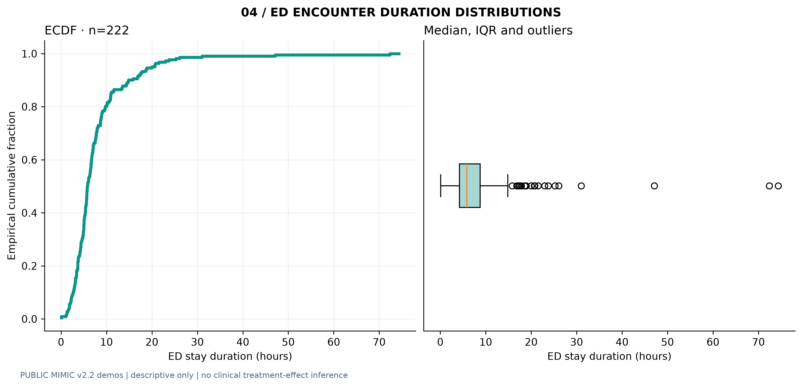
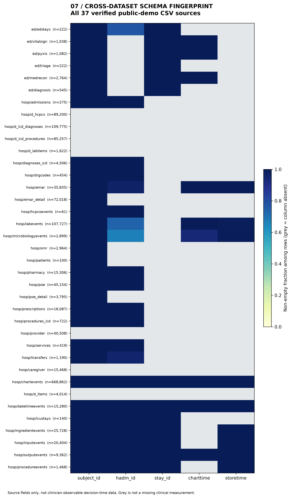

# Clinical observation atlas

**Seven descriptive figures, two public MIMIC demonstration datasets, and one traceable evidence package.** All figures are generated from real public-demo source files. The panel labels refer to source records and ED stays, not prediction model performance.

[Project overview](../../README.md) · [Figure methods and denominators](../../docs/FIGURES.md) · [Study protocol](../../docs/PROTOCOL.md) · [Source-table inventory](all_source_schema_inventory.json) · [Machine-readable aggregate results](aggregate_results.json)

### Clinical observation coverage

### Missingness and timing

### Data lineage and schema integrity

All images have an [SVG vector equivalent](figures/). ED, lab and eMAR timestamps are **documentation or storage proxies**; they do not establish when a treating clinician had access to the record. Low-count observation cells are suppressed.

The `index.html` file is an **offline local dashboard**; GitHub's app displays HTML source. To use it, [download and extract the repository](https://github.com/Farshidbagheri/Observation-aware-ehr-data/archive/refs/heads/main.zip), keeping the `figures/` directory beside the HTML file, and open it in a browser. [Viewer instructions](../../docs/DASHBOARD.md).
